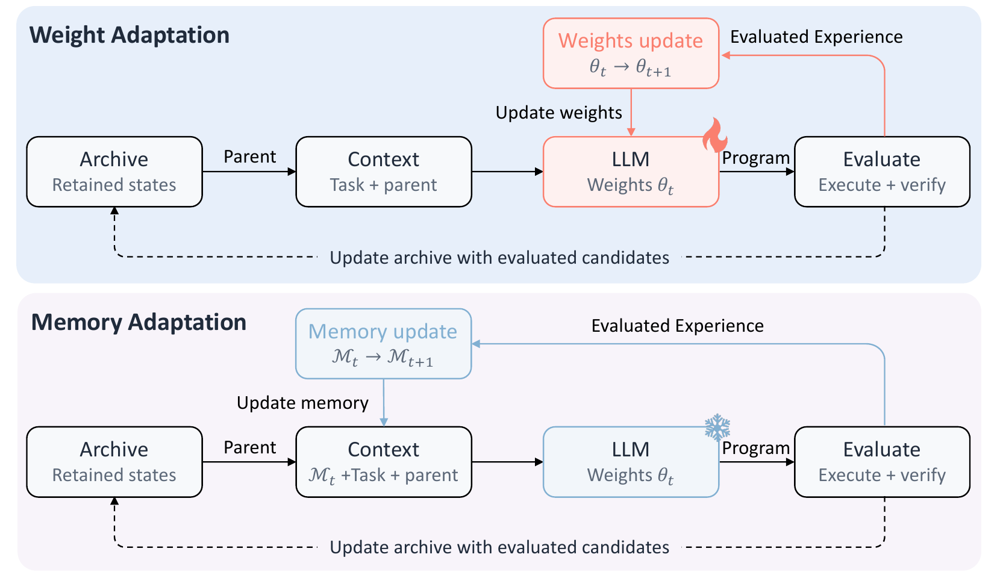

<h1 align="center">Can Test-Time Memory Evolution Outperform Test-Time Training </br> for Scientific Discovery?</h1>

<p align="center">
  <b>Yepeng Liu<sup>*</sup></b>, <b>Shengmai Chen<sup>*</sup></b>, Xuandong Zhao, Chengzhi Liu,<br>
  Dawn Song, Xin Eric Wang, Yuheng Bu
</p>

<p align="center">
  UC Santa Barbara &nbsp;·&nbsp; UC Berkeley<br>
  <sub><sup>*</sup> Equal contribution</sub>
</p>

<p align="center">
  <a href="https://arxiv.org/abs/2610.32046"></a>
  &nbsp;
  <a href="https://github.com/yepengliu/TTME"></a>
  &nbsp;
  <a href="results/README.md"></a>
</p>

<p align="center">
  <sub><a href="#overview">Overview</a> &nbsp;·&nbsp;
  <a href="#results">Results</a> &nbsp;·&nbsp;
  <a href="#quick-start">Quick start</a> &nbsp;·&nbsp;
  <a href="docs/usage.md">Usage guide</a> &nbsp;·&nbsp;
  <a href="#citation">Citation</a></sub>
</p>

**Test-Time Memory Evolution (TTME)** adapts external memory during scientific
discovery while keeping model weights fixed. It turns execution feedback into practical
guidelines and successful algorithmic ideas into reusable search strategies.

## Overview

<p align="center">
  
</p>

<p align="center"><sub>Figure 2 from the paper. Both methods retain the discovery framework; TTME adapts the memory used to guide generation.</sub></p>

TTME maintains two complementary memories:

- **Guideline Memory** distills execution and evaluation feedback into shared lessons for implementing reliable candidates.
- **Strategy Memory** consolidates successful algorithmic ideas and adapts relevant strategies for subsequent search.

## Results

The following are the **TTME results reported in Tables 1 and 2**. Arrows indicate
whether a lower (↓) or higher (↑) score is better.

**TTT-Discover framework · 50 search steps**

| Model | AC1 ↓ | AC2 ↑ | Erdős ↓ |
|:--|--:|--:|--:|
| Qwen3-8B | 1.504329 | 0.949248 | 0.380927 |
| gpt-oss-120b | **1.502745** | **0.960784** | **0.380862** |

**ThetaEvolve framework · 65 search steps**

| Model | AC2 ↑ | AC3 ↓ | Hadamard ↑ |
|:--|--:|--:|--:|
| Distill-Qwen3-8B | 0.948148 | 1.464224 | 0.579938 |

Distill-Qwen3-8B denotes DeepSeek-R1-0528-Qwen3-8B. See the [paper](https://arxiv.org/abs/2610.32046)
for the TTT and search-only comparisons.

All **nine reported constructions** are included at full precision, with a
[verification script](scripts/verify_results.py) and [SHA-256 manifest](results/manifest.json).
See the [construction catalog](results/README.md) for each array and its provenance.

## Quick start

### Verify the constructions

With Python 3.10 or newer, these commands reproduce the stored construction scores
on a CPU. No model download is required.

```bash
git clone https://github.com/yepengliu/TTME.git
cd TTME
python -m pip install -c requirements.lock -e .
python scripts/verify_results.py
```

The verifier checks the saved arrays, hashes, validity, search budgets and agreement
with the paper. A successful run ends with `9/9 constructions verified`.

### Run a search

Search and evaluation workers require **Linux**. Download a model snapshot at the
[documented revision](docs/usage.md#models), then run a memory-enabled experiment:

```bash
python -m pip install -c requirements.lock -e ".[programs,serve]"
export MODEL_PATH=models/Qwen3-8B
scripts/local/run_local.sh \
  configs/experiments/ac2_memory_8b.yaml \
  runs/ac2_memory_8b 16
```

The launcher starts a model server, runs the search and stops the server when finished.
All commands are run from the repository root.

For cluster jobs, resuming runs, model settings and experiment variants, see the
[complete usage guide](docs/usage.md).

## Repository guide

| Location | Contents |
|:--|:--|
| [`ttt/`](ttt/) | Search, memory, archive and evaluation implementation |
| [`configs/`](configs/) | Model settings, baseline experiments and memory ablations |
| [`scripts/`](scripts/) | Local and Slurm launchers; construction verification |
| [`results/`](results/) | The nine paper-reported TTME constructions |
| [`docs/usage.md`](docs/usage.md) | Installation, pinned model revisions and full run instructions |

This release provides the **TTT-Discover search implementation** for AC1, AC2 and
Erdős. The ThetaEvolve results are provided as stored constructions and scoring
code; its search runner is not included in this release.

Generated programs execute with the worker account's filesystem and network permissions.
Run evaluation workers in a container or under a separate account; see the
[execution notes](docs/usage.md#safety).

## Citation

If you use TTME, please cite the paper.

<details>
<summary>BibTeX</summary>

```bibtex
@misc{liu2026ttme,
  title         = {Can Test-Time Memory Evolution Outperform Test-Time Training
                   for Scientific Discovery?},
  author        = {Liu, Yepeng and Chen, Shengmai and Zhao, Xuandong and Liu, Chengzhi
                   and Song, Dawn and Wang, Xin Eric and Bu, Yuheng},
  year          = {2026},
  eprint        = {2610.32046},
  archivePrefix = {arXiv},
  primaryClass  = {cs.AI},
  url           = {https://arxiv.org/abs/2610.32046}
}
```

</details>

## Acknowledgments and license

This repository builds on [TTT-Discover](https://github.com/test-time-training/discover)
and includes evaluation material derived from [ThetaEvolve](https://github.com/ypwang61/ThetaEvolve).
See [LICENSE](LICENSE), [NOTICE](NOTICE) and the [third-party license](LICENSES/Apache-2.0.txt)
for the MIT and Apache-2.0 terms that apply to each component.
